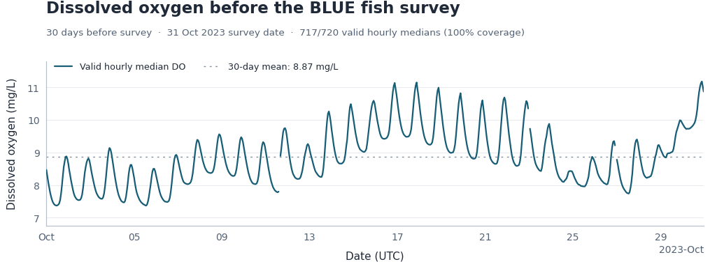
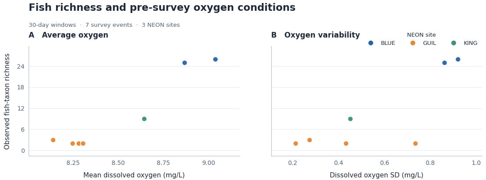

# Beyond Mean Dissolved Oxygen
### A reproducible NEON freshwater fish–oxygen pilot

**Research stage:** preliminary data-feasibility analysis · **Study sites:** `GUIL`, `BLUE`, `KING` · **NEON release:** `RELEASE-2026`

This repository provides the code, workflow, archived figures, and scientific caveats for a pilot exploring whether **pre-survey dissolved-oxygen variability** can be quantified alongside freshwater fish-community observations. It supports the development of a Kentucky Academy of Science (KAS) Special Research Program proposal; it is **not** a record of an awarded grant or a validated ecological effect.

[NEON fish counts](https://data.neonscience.org/data-products/DP1.20107.001) · [NEON water quality](https://data.neonscience.org/data-products/DP1.20288.001) · [Analysis Platform used Google Colab](https://colab.research.google.com/)

## Pilot results at a glance

| Recorded pilot measure | Archived value |
|:--|--:|
| Sites | 3 (`GUIL`, `BLUE`, `KING`) |
| Fish-capture survey events | 12 |
| Events with usable 30-day pre-survey oxygen histories | **7 / 12** |
| Events with usable 7-day / 14-day histories | **8 / 12** each |
| BLUE 30-day pre-survey oxygen coverage (31 Oct 2023) | **717 / 720 hours = 99.6%** |
| BLUE hourly median oxygen range | **7.37–11.18 mg/L** |
| BLUE hourly median oxygen mean | **8.87 mg/L** |
| Events below the illustrative 5 mg/L reference in 30-day matched windows | **0 / 7** |
| Held-out-site prediction | **Not performed** (insufficient independent data) |

These numbers summarize a **saved prior notebook run**; they have **not** been independently recomputed from NEON by this cleaned repository. Exploratory fish-taxon richness has not been standardized for sampling effort and may contain zero-count taxon artifacts. See [Pilot findings](docs/PILOT_FINDINGS.md) for the detailed data lineage and cautions.

## Figures from the saved pilot

**Figure 1.** Quality-screened hourly dissolved oxygen before the BLUE fish survey. The curve shows temporal variation, not a fish-health threshold result.



**Figure 2.** Across seven usable 30-day event windows, observed fish-taxon richness is plotted against mean DO (A) and DO standard deviation (B), with site identity shown by color. The comparisons are **descriptive**: differences among sites, sampling effort, habitat, and timing are not controlled.



## Run it in Google Colab (recommended)

1. Download or open [`notebooks/KAS_NEON_Fish_Oxygen_Pilot.ipynb`](notebooks/KAS_NEON_Fish_Oxygen_Pilot.ipynb) in [Google Colab](https://colab.research.google.com/). Once the repository is published, GitHub's notebook file can also be opened from the Colab interface.
2. In NEON's [Data Portal](https://data.neonscience.org/), create or use your research account and obtain a personal **API token**. The notebook uses a hidden prompt; **never save or commit the token**.
3. Select **Runtime → Run all**. The first code cell installs required Python packages. Check the selected site-month plan, download log, sensor choices, and missing-data coverage.
4. Inspect the output folder `/content/kas_neon_fish_pilot/` and its generated ZIP of processed tables and new figures. Differences from archived values may reflect updated data, dependencies, site/month availability, or methodological changes.

**Python script alternative** (Python 3.10+; from repository root):

```bash
python -m pip install -r requirements.txt
python scripts/neon_fish_oxygen_pilot.py
```

Results are created in `./kas_neon_fish_pilot/` outside Colab. The downloaded raw cache, token, and generated files are **git-ignored**.

## Project structure

```text
KAS-NEON-Fish-Oxygen/
├── notebooks/
│   └── KAS_NEON_Fish_Oxygen_Pilot.ipynb    # standalone Colab analysis
├── scripts/
│   └── neon_fish_oxygen_pilot.py          # same analysis as a Python script
├── figures/                              # archived, real pilot figures
├── docs/
│   ├── PILOT_FINDINGS.md                 # recorded findings and provenance
│   ├── METHODS_AND_LIMITATIONS.md       # methods, scope and scientific cautions
│   ├── UNDERGRADUATE_GUIDE.md           # undergraduate research tasks
│   ├── REPRODUCIBILITY.md               # re-running and change log
│   └── GITHUB_PUBLISHING_GUIDE.md       # safe GitHub publishing steps
├── tests/
│   └── test_offline_smoke.py             # no-network validation
├── requirements.txt
├── CITATION.cff
├── LICENSE
└── .gitignore
```

## Research design and interpretation

The pilot selects up to four recent eligible fish-data months for each of three *fixed* NEON sites. It joins positive-quality sensor readings to captured-fish survey events using **7-, 14-, and 30-day** pre-survey windows. To avoid silently inventing oxygen exposure, an hourly median requires ≥20 valid measurements and a window requires ≥70% hourly coverage. The code intentionally does **not** extrapolate causal effects or fit a site-held-out model when the available sample is too small.

**Important scientific caveat:** the archived richness calculation counts distinct taxon groups from individual-fish and bulk-count records. Zero-count bulk rows may contribute taxa to that quantity. A non-modifying diagnostic is now generated as `tables/zero_count_taxon_audit.csv`; if any such rows occur, analyze strictly positive captures in an explicitly versioned follow-up, rather than quietly changing the archived figures.

Read [Methods and limitations](docs/METHODS_AND_LIMITATIONS.md) before interpreting the figures or copying results into a grant narrative. For a proposed grant citation and publication steps, see the [GitHub publishing guide](docs/GITHUB_PUBLISHING_GUIDE.md).

## Reuse and citation

Code is offered under the **MIT License** (subject to the repository owner's approval before publication). NEON data are **not** included in this ZIP: request them from the original provider and use the provider's stated citation and license. This repository's `CITATION.cff` supplies a citation format for the code only.

**NEON source products used by the original notebook:**

- **Fish electrofishing, gill netting, and fyke netting counts**, `DP1.20107.001` (source notebook lists DOI: [10.48443/s1e6-df79](https://doi.org/10.48443/s1e6-df79)).
- **Water quality**, `DP1.20288.001` (source notebook lists DOI: [10.48443/15k3-aj25](https://doi.org/10.48443/15k3-aj25)).

Both were requested from `RELEASE-2026`. Confirm the official release-specific attribution in the NEON portal when publishing results.

**Research integrity:** Archived figures demonstrate a working data linkage and a descriptive result. They do not prove that oxygen variability determines fish richness, and they do not constitute a complete study of fish ecological responses.
